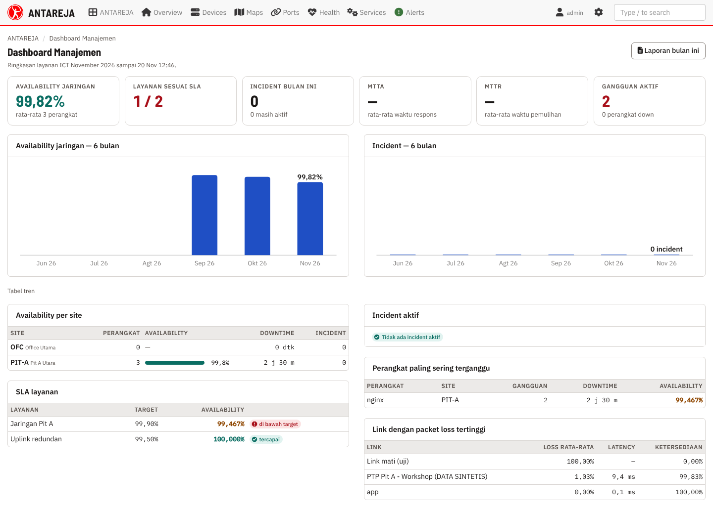
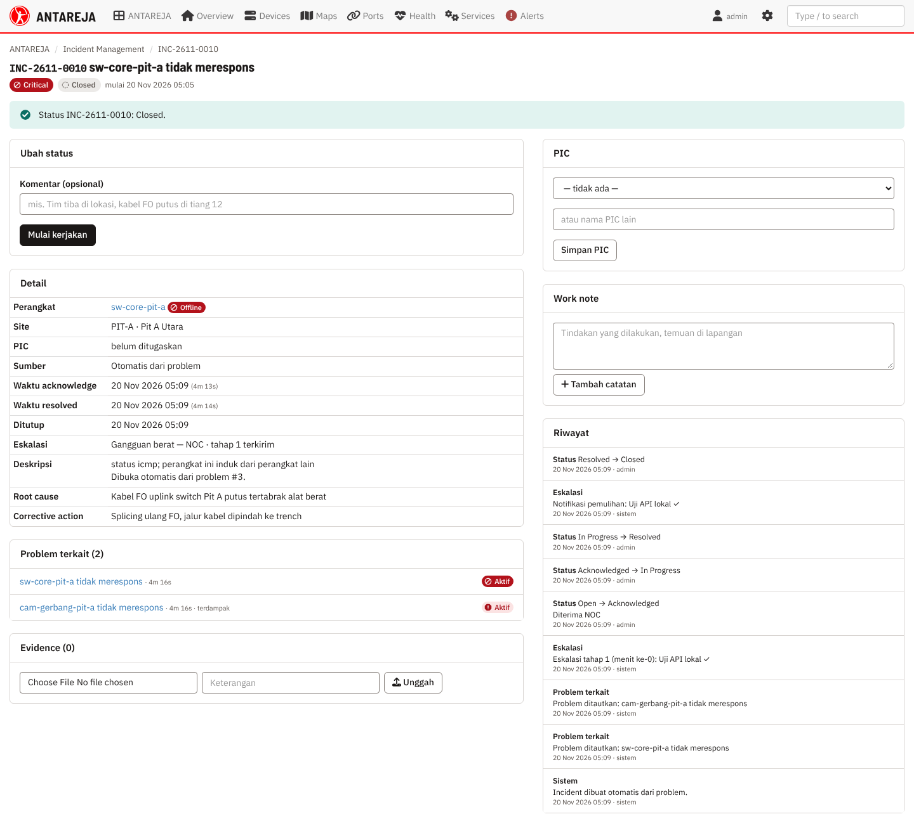
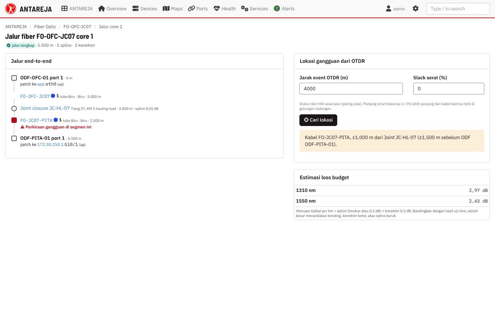

<p align="center">
  
</p>

<h1 align="center">ANTAREJA NMS</h1>

<p align="center">
  <strong>Mining ICT Infrastructure Management &amp; Unified Network Monitoring Platform</strong><br>
  Satu aplikasi web untuk memantau dan mengelola jaringan, CCTV, dan infrastruktur ICT di area tambang.
</p>

<p align="center">
  Versi 0.6.0 · Berbasis LibreNMS 26.10.2 · Lisensi GPL-3.0 · Bahasa antarmuka: Indonesia
</p>

---

## Daftar isi

1. [Tentang ANTAREJA NMS](#1-tentang-antareja-nms)
2. [Fitur](#2-fitur)
3. [Tampilan](#3-tampilan)
4. [Arsitektur singkat](#4-arsitektur-singkat)
5. [Kebutuhan sistem](#5-kebutuhan-sistem)
6. [Instalasi di Proxmox (langkah demi langkah)](#6-instalasi-di-proxmox-langkah-demi-langkah)
7. [Konfigurasi awal setelah login](#7-konfigurasi-awal-setelah-login)
8. [Peran pengguna (role)](#8-peran-pengguna-role)
9. [Operasional sehari-hari](#9-operasional-sehari-hari)
10. [Fitur opsional: asisten AI, proxy, offline](#10-fitur-opsional-asisten-ai-proxy-offline)
11. [Tugas terjadwal otomatis](#11-tugas-terjadwal-otomatis)
12. [Keamanan](#12-keamanan)
13. [Pemecahan masalah](#13-pemecahan-masalah)
14. [Struktur repositori](#14-struktur-repositori)
15. [Dokumentasi lengkap](#15-dokumentasi-lengkap)
16. [Lisensi & atribusi](#16-lisensi--atribusi)

---

## 1. Tentang ANTAREJA NMS

ANTAREJA NMS menggabungkan kemampuan tiga alat monitoring populer dalam **satu aplikasi dan satu login**:

| Asal fitur | Yang dibawa ke ANTAREJA |
|---|---|
| **LibreNMS** (basis fork) | Auto-discovery, polling SNMP/ICMP, status perangkat & port, sensor, wireless, grafik, alert rule, transport notifikasi (Telegram, email, dll.) |
| **Zabbix** (dibuat ulang secara native) | Problem & korelasi event, trigger expression, acknowledge, eskalasi, maintenance, SLA & service tree |
| **SmokePing** (dibuat ulang secara native) | Quality Probe: latency, packet loss, jitter, grafik "smoke" |

Ditambah modul khusus kebutuhan operasional tambang: inventaris resmi per site/area, verifikasi perangkat hasil discovery,
device mapping terverifikasi, IPAM, CCTV, incident & work order, change request, backup konfigurasi, capacity planning,
manajemen fiber optic, laporan bulanan, dan dashboard manajemen.

**Prinsip desain**
- Semua fitur berjalan **di server Anda sendiri** (VM Proxmox) dan tetap berfungsi **tanpa internet**. Hanya asisten AI yang opsional butuh internet.
- ANTAREJA **tidak pernah mengubah konfigurasi perangkat jaringan**. Backup konfigurasi hanya memakai perintah baca; AI hanya menulis draf teks.
- Topologi tidak ditebak: hubungan antar perangkat berasal dari **mapping yang diverifikasi engineer**.
- Setiap perubahan data penting tercatat di **audit log**.

---

## 2. Fitur

### Monitoring
| Modul | Isi |
|---|---|
| **Network Monitoring** | Status perangkat (SNMP v2c/v3, ICMP), uptime, sensor hardware, grafik — dari LibreNMS |
| **Interface Monitoring** | Status port, traffic, bandwidth, error, utilisasi |
| **Wireless Monitoring** | AP, controller, PTP/PTMP: client, RSSI, SNR, frekuensi, CCQ, pasangan link |
| **CCTV Infrastructure** | Kamera & NVR: status, IP, MAC, port switch, NVR perekam, lokasi, riwayat gangguan |
| **Network Quality** | Quality Probe (20 ping tiap 5 menit): latency, loss, jitter, grafik smoke 3 jam – 30 hari |

### Inventaris & jaringan
| Modul | Isi |
|---|---|
| **Site & Area** | Office, workshop, plant, pit, ROM, jetty, mess, remote, beserta area di dalamnya |
| **Device Inventory** | Kategori, site/area, rak, serial, PIC, garansi, lifecycle, evidence foto/PDF, kelengkapan data, export CSV |
| **Device Discovery** | Perangkat baru masuk antrean verifikasi: Pending → Verified / Incomplete / Rejected / Retired |
| **Device Mapping** | Relasi port ↔ perangkat yang diverifikasi; saran dari LLDP/CDP & tabel MAC; dipakai untuk korelasi induk/anak |
| **IP Address Management** | Subnet, VLAN, alokasi IP, IP kosong, peta alamat, deteksi konflik/duplikat, histori per IP, utilisasi |

### Gangguan & operasional
| Modul | Isi |
|---|---|
| **Event & Alert Center** | Problem dari semua sumber dalam satu daftar; gangguan yang sama digabung; perangkat anak ditekan bila induknya down |
| **Trigger** | Kondisi ambang ala Zabbix, mis. "rata-rata packet loss 15 menit > 5%", "utilisasi uplink > 80% (pulih ≤ 70%)" |
| **Incident Management** | Nomor INC, severity, PIC, status, root cause & corrective action wajib saat ditutup, work note, evidence, MTTA/MTTR |
| **Eskalasi & Notifikasi** | Incident otomatis & notifikasi bertahap lewat Telegram/email/dll. sampai di-acknowledge |
| **Maintenance** | Kalender preventive/corrective/change; alert perangkat ditekan selama jendela; bisa dikecualikan dari SLA |
| **Work Order** | Pekerjaan lapangan dengan checklist, material, evidence, tenggat per prioritas, verifikasi supervisor |
| **Change Request** | Rencana, dampak, rollback; disetujui orang lain; otomatis jadi jendela maintenance |
| **Backup Konfigurasi** | SSH (perintah baca saja) ke 10 profil vendor; versi & diff; deteksi perubahan tanpa change request |

### Analisis & laporan
| Modul | Isi |
|---|---|
| **SLA Management** | Service tree (seri / redundan / minimal N up), target SLA, availability bulanan, MTTR/MTBF |
| **Capacity Planning** | Utilisasi uplink (p95 harian), storage NVR/server, pool IP, perkiraan tanggal menyentuh ambang |
| **Fiber Optic** | Kabel & core (warna TIA-598), ODF, joint & splice, uji OTDR, jalur end-to-end, lokasi gangguan dari jarak OTDR |
| **Deteksi Anomali** | Latency/loss/traffic tidak wajar & perangkat flapping, dibanding jam yang sama hari sebelumnya — offline, tanpa AI |
| **Asisten AI** (opsional) | Draf laporan serah terima shift & analisis incident — hanya teks, tanpa akses ke perangkat |
| **Dashboard Manajemen** | KPI availability, SLA, incident, MTTA/MTTR, tren 6 bulan, per site |
| **Reports** | Laporan bulanan 9 bagian per site: cetak/PDF, Excel, CSV |
| **Audit Log** | Jejak login & perubahan data (sebelum/sesudah) |

---

## 3. Tampilan

> Gambar memakai data uji.

| Dashboard manajemen | Incident |
|---|---|
|  |  |
| **SLA layanan** | **Capacity planning** |
|  |  |
| **Jalur fiber & lokasi gangguan OTDR** | **Backup konfigurasi & diff** |
|  |  |

---

## 4. Arsitektur singkat

ANTAREJA berjalan sebagai beberapa container Docker di **satu VM**:

```
 Pengguna (browser) ──HTTPS 443──▶ nginx ──▶ app (ANTAREJA + LibreNMS, PHP/Laravel)
                                              │        ├─ scheduler (problem, SLA, kapasitas, anomali, backup konfigurasi)
                                              │        └─ Quality Probe (fping)
                                              ├─▶ db (MariaDB)        ├─▶ redis (cache & sesi)
                                              └─▶ rrdcached (grafik)  └─▶ dispatcher (poller SNMP/ICMP)
                                                         │
                         Perangkat jaringan ◀── SNMP UDP 161 / ICMP / SSH 22 (opsional, backup konfigurasi)
```

- Kode ANTAREJA berada di `packages/antareja/` sebagai paket Laravel; perubahan pada kode LibreNMS dibuat seminimal mungkin
  dan dicatat di [`MODIFICATIONS.md`](MODIFICATIONS.md).
- Data tersimpan di volume Docker (database, RRD, evidence) dan ikut di-backup oleh `./antareja.sh backup`.

---

## 5. Kebutuhan sistem

| Skala | vCPU | RAM | Disk (SSD) |
|---|---|---|---|
| sampai ±150 perangkat | 4 | 8 GB | 120 GB |
| ±500 perangkat | 6–8 | 16 GB | 200–250 GB |

- **OS:** Ubuntu Server 24.04 LTS (VM di Proxmox VE, atau server Linux lain yang bisa menjalankan Docker).
- **Jaringan:** IP statis di **VLAN manajemen** yang punya rute ke semua subnet perangkat.
- **Firewall:**
  - Pengguna → VM: TCP 443 (dan 80, otomatis dialihkan ke 443).
  - VM → perangkat: ICMP dan UDP 161 (SNMP). TCP 22 bila memakai backup konfigurasi. Opsional: UDP 162 masuk (SNMP trap).
- **Internet:** dibutuhkan **saat instalasi/update** (mengunduh image Docker dan paket). Setelah berjalan, internet tidak wajib.

---

## 6. Instalasi di Proxmox (langkah demi langkah)

### 6.1 Buat VM

1. Unduh ISO **Ubuntu Server 24.04 LTS**, lalu di Proxmox: storage `local` → **ISO Images** → **Upload**.
2. Klik **Create VM**:

   | Tab | Isian |
   |---|---|
   | General | Name: `antareja` |
   | OS | ISO Ubuntu Server 24.04 |
   | System | Qemu Agent: ✓ |
   | Disks | Bus VirtIO SCSI, 120 GB (atau 200 GB untuk ±500 perangkat), storage SSD, Discard ✓ |
   | CPU | 4 core (6–8 untuk ±500 perangkat), Type: `host` |
   | Memory | 8192 MB (16384 untuk ±500 perangkat) |
   | Network | Bridge ke VLAN manajemen (isi *VLAN Tag* bila memakai VLAN), Model VirtIO |

3. **Start** VM, buka **Console**, lalu instal Ubuntu:
   - Atur **IP statis** pada VLAN manajemen.
   - Centang **Install OpenSSH server**.
   - Jangan memilih snap Docker di layar *Featured snaps* (Docker dipasang di langkah berikut).
4. Setelah selesai, masuk lewat SSH dari laptop:

```bash
ssh <user>@<IP-VM>
```

### 6.2 Pasang Docker

```bash
sudo apt update && sudo apt install -y ca-certificates curl git openssl qemu-guest-agent
```

```bash
curl -fsSL https://get.docker.com | sudo sh
```

```bash
sudo usermod -aG docker $USER && newgrp docker
```

### 6.3 Ambil kode ANTAREJA

```bash
sudo mkdir -p /opt/antareja && sudo chown $USER /opt/antareja
```

```bash
git clone https://github.com/aidilandriandas/antareja-nms.git /opt/antareja && cd /opt/antareja
```

> **Repo private?** Saat diminta login, isi username GitHub dan tempelkan **Personal Access Token** sebagai password
> (GitHub → Settings → Developer settings → Personal access tokens, cukup izin baca repo).

### 6.4 Jalankan instalasi

```bash
ANTAREJA_SERVER_NAME=antareja.local ./antareja.sh install
```

Ganti `antareja.local` dengan nama DNS yang akan dipakai pengguna (atau biarkan bila akses lewat IP). Skrip akan:

1. membuat `docker/.env` dengan password database acak,
2. membuat sertifikat HTTPS self-signed (sudah mencakup IP VM),
3. membangun image dan menjalankan semua container (pertama kali ±10–20 menit),
4. menanyakan **username dan password admin**.

### 6.5 Buka aplikasi

Buka `https://<IP-VM>/`. Browser akan memperingatkan sertifikat self-signed — lanjutkan, lalu login sebagai admin.
Cek kesehatan sistem:

```bash
./antareja.sh health
```

Hasil yang diharapkan diakhiri tulisan **SEHAT**.

> Punya sertifikat dari CA perusahaan? Ganti `docker/certs/antareja.crt` dan `docker/certs/antareja.key`, lalu `./antareja.sh restart`.

---

## 7. Konfigurasi awal setelah login

1. **SNMP:** menu *Settings → Global Settings → Poller → SNMP* — isi community v2c read-only (jangan `public`) atau kredensial SNMPv3.
2. **Tambah perangkat:** menu *Devices → Add Device*, atau lewat terminal:
   ```bash
   ./antareja.sh lnms device:add 10.10.1.1 --v2c -c <community>
   ```
   Auto-discovery satu subnet (hanya setelah ada izin tertulis IT Security):
   ```bash
   ./antareja.sh lnms config:set nets.+ '10.10.0.0/16'
   ```
3. **Site & Area:** menu *ANTAREJA → Site & Area* — buat site (Kantor, Pit A, Workshop, …) dan area di dalamnya.
4. **Verifikasi perangkat:** menu *Device Discovery* — lengkapi kategori, site, PIC, lalu setujui.
5. **Device Mapping:** catat uplink antar perangkat (switch core → radio PTP → switch pit → kamera). Ini mengaktifkan
   korelasi gangguan induk/anak dan mengisi Capacity Planning otomatis.
6. **Quality Probe:** menu *Network Quality* — tambahkan target link penting (PTP, uplink antar site, gateway internet).
7. **Notifikasi:** buat transport di *Alerts → Alert Transports* (mis. Telegram), lalu kebijakan di *Eskalasi & Notifikasi*.
8. **SLA:** menu *SLA Management* — buat layanan seperti "Jaringan Pit A" dan pilih perangkatnya.
9. **User:** buat akun tim dan beri role yang sesuai (lihat bagian berikut).

---

## 8. Peran pengguna (role)

| Role | Kode | Cakupan utama |
|---|---|---|
| **ICT Network** | `ict-network` | Monitoring, inventaris, IPAM, mapping, problem & incident, trigger, SLA, work order, change, backup konfigurasi, kapasitas, fiber, asisten AI |
| **ICT CCTV / Support** | `ict-cctv-support` | CCTV, inventaris, incident & work order, maintenance, fiber, change (mengajukan), asisten AI |
| **ICT Admin** | `admin` | Semua akses, termasuk pengaturan sistem & user |
| **Management** | `management` | Dashboard manajemen, laporan & export, SLA, problem/incident (lihat saja), menyetujui change request |

Hak akses bisa disesuaikan per permission di *ANTAREJA → User Management → Roles* (grup `ant-*`).

---

## 9. Operasional sehari-hari

| Perintah | Fungsi |
|---|---|
| `./antareja.sh start` / `stop` / `restart` / `status` | Kontrol layanan |
| `./antareja.sh logs app` | Lihat log (`app`, `dispatcher`, `db`, `nginx`) |
| `./antareja.sh health` | Cek container, database, Redis, HTTPS, poller, disk |
| `./antareja.sh backup` | Backup database + data + RRD ke `docker/backups/` (rotasi 14 hari) |
| `./antareja.sh restore <file>` | Pulihkan dari backup |
| `./antareja.sh update` | Backup → git pull → build → restart → cek kesehatan |
| `./antareja.sh admin` | Buat user admin baru |
| `./antareja.sh lnms <perintah>` | Jalankan perintah LibreNMS/ANTAREJA (mis. `device:add`, `antareja:problems`) |

**Backup harian otomatis:**

```bash
(crontab -l 2>/dev/null; echo "30 1 * * * cd /opt/antareja && ./antareja.sh backup >> /var/log/antareja-backup.log 2>&1") | crontab -
```

Salin isi `docker/backups/` ke NAS/share di luar VM secara berkala, dan aktifkan juga backup VM mingguan di Proxmox
(*Datacenter → Backup → Add*).

**Update ke versi terbaru:**

```bash
cd /opt/antareja && ./antareja.sh update
```

---

## 10. Fitur opsional: asisten AI, proxy, offline

### Asisten AI (Claude API)
Membuat draf laporan serah terima shift dan analisis incident. Butuh internet dari VM ke `api.anthropic.com` dan
menimbulkan biaya API per draf. Tanpa kunci, fitur ini nonaktif dan semua fitur lain tetap berjalan.

1. Buat API key di console Anthropic.
2. Isi di `docker/.env`:
   ```
   ANTAREJA_AI_KEY=<api key>
   ANTAREJA_AI_MODEL=claude-opus-5-5
   ```
3. Terapkan:
   ```bash
   ./antareja.sh restart
   ```

Yang **tidak pernah** dikirim ke AI: isi konfigurasi perangkat, kredensial, email/telepon. Alamat IP & MAC disamarkan.
Tombol **Lihat data** menampilkan persis teks yang akan dikirim.

### Build lewat proxy kantor
Isi di `docker/.env` sebelum `install`/`update`:
```
BUILD_HTTPS_PROXY=http://proxy.kantor:3128
DOCKER_BUILD_NETWORK=default
```
Bila proxy memeriksa TLS, simpan sertifikat CA proxy di `docker/build-ca.crt`.

### VM tanpa internet
Bangun image di mesin yang punya internet, lalu pindahkan:
```bash
docker save antareja-nms:0.6.0 | gzip > antareja-nms-0.6.0.tar.gz
```
```bash
gunzip -c antareja-nms-0.6.0.tar.gz | docker load
```
Image pihak ketiga (`mariadb`, `redis`, `crazymax/rrdcached`, `nginx`, `librenms/librenms`) dipindahkan dengan cara yang sama.

---

## 11. Tugas terjadwal otomatis

Berjalan sendiri di dalam container `app` — tidak perlu cron tambahan.

| Tugas | Jadwal |
|---|---|
| Problem engine, trigger, maintenance, eskalasi | tiap menit |
| Quality Probe | tiap 5 menit |
| Sinkron inventaris & IPAM | tiap 15 menit |
| Deteksi anomali | tiap 15 menit |
| Saran mapping (LLDP/CDP) | tiap jam |
| Backup konfigurasi (perangkat yang sudah waktunya) | tiap jam |
| Capacity planning | tiap 6 jam |
| Rollup kualitas harian | 00:20 |
| Pembekuan SLA bulan lalu | 00:35 |

---

## 12. Keamanan

- Hanya Nginx yang terbuka (443/80); database, Redis, dan rrdcached berada di jaringan Docker internal.
- Password database dibuat acak saat instalasi; `docker/.env` tidak pernah di-commit.
- Kredensial SSH backup konfigurasi dan isi konfigurasi disimpan **terenkripsi**; password tidak pernah ditampilkan kembali
  dan disamarkan di audit log. Host key SSH diverifikasi.
- Backup konfigurasi hanya menjalankan perintah **baca** dari daftar tetap per vendor. Gunakan akun read-only di perangkat.
- Change request tidak bisa disetujui oleh pengajunya sendiri; work order tidak bisa diverifikasi oleh pelaksananya.
- Kunci API AI hanya disimpan di server dan tidak pernah dikirim ke browser.
- Gunakan SNMPv3 (authPriv) bila perangkat mendukung; untuk v2c gunakan community read-only, bukan `public`.
- Mintalah persetujuan tertulis atasan/IT Security sebelum memindai (discovery) jaringan perusahaan.

---

## 13. Pemecahan masalah

| Gejala | Penyebab & solusi |
|---|---|
| `./antareja.sh install` gagal saat build, "Could not authenticate against github.com" / timeout | VM tidak bisa mengunduh paket. Periksa internet/proxy (bagian 10) |
| Halaman tidak bisa dibuka | `./antareja.sh status` dan `./antareja.sh logs nginx`; pastikan firewall membuka TCP 443 |
| Perangkat selalu down | Cek ping & SNMP dari VM: `./antareja.sh lnms device:poll <hostname> -v`; periksa community & ACL SNMP di perangkat |
| Grafik kosong | Perangkat baru butuh 2× polling (±10 menit) sebelum traffic port muncul |
| Setelah login kembali lagi ke halaman login | Akses selalu lewat `https://` dengan alamat yang sama (IP atau nama), lalu hapus cookie browser untuk alamat itu. Bila `DOCKER_SUBNET` diubah, jalankan `./antareja.sh restart` |
| Subnet `172.30.250.0/24` bentrok dengan jaringan tambang | Ubah `DOCKER_SUBNET` di `docker/.env` **sebelum** instalasi |
| Backup konfigurasi gagal "Host key berubah" | Perangkat diganti/di-reset: buka halaman konfigurasi perangkat → centang *Reset host key* |
| Asisten AI nonaktif | Isi `ANTAREJA_AI_KEY` di `docker/.env` lalu `./antareja.sh restart`; VM harus bisa ke `api.anthropic.com` |

Kirim keluaran `./antareja.sh health` dan `./antareja.sh logs app` saat meminta bantuan.

---

## 14. Struktur repositori

```
packages/antareja/      Semua fitur ANTAREJA (paket Laravel)
  ├─ src/               Model, service, controller, perintah artisan
  ├─ resources/views/   Halaman (Blade)
  ├─ resources/css/     Design system ANTAREJA
  ├─ database/          Migrasi tabel ant_*
  └─ routes/web.php     Route /antareja/...
docker/                 Dockerfile, compose.yml, Nginx, konfigurasi branding
antareja.sh             Skrip operasional (install, backup, update, …)
docs/                   Panduan instalasi, dokumen per fase, arsitektur, screenshot
html/images/antareja/   Logo & favicon
(lainnya)               Kode LibreNMS (fork; perubahan dicatat di MODIFICATIONS.md)
```

---

## 15. Dokumentasi lengkap

| Dokumen | Isi |
|---|---|
| [`docs/INSTALL.md`](docs/INSTALL.md) | Panduan instalasi & operasional |
| [`docs/FASE-1-Inventaris.md`](docs/FASE-1-Inventaris.md) | Site, inventaris, discovery, mapping, audit, kelengkapan data |
| [`docs/FASE-2-IPAM-Kualitas.md`](docs/FASE-2-IPAM-Kualitas.md) | IPAM, Network Quality, Wireless, CCTV |
| [`docs/FASE-3-Problem-Incident.md`](docs/FASE-3-Problem-Incident.md) | Event & Alert Center, incident, eskalasi, maintenance |
| [`docs/FASE-4-SLA-Laporan.md`](docs/FASE-4-SLA-Laporan.md) | SLA, trigger, dashboard manajemen, laporan |
| [`docs/FASE-5-Lanjutan.md`](docs/FASE-5-Lanjutan.md) | Work order, change, backup konfigurasi, capacity, fiber, anomali, AI |
| [`docs/ANTAREJA-NMS-Arsitektur-v0.2-Fork.md`](docs/ANTAREJA-NMS-Arsitektur-v0.2-Fork.md) | Arsitektur & keputusan desain |
| [`MODIFICATIONS.md`](MODIFICATIONS.md) | Daftar perubahan terhadap kode LibreNMS & prosedur sinkron upstream |
| [`ANTAREJA.md`](ANTAREJA.md) | Ringkasan proyek |

---

## 16. Lisensi & atribusi

ANTAREJA NMS adalah **fork dari [LibreNMS](https://www.librenms.org)** dan didistribusikan di bawah
**GNU General Public License v3.0 atau lebih baru** — lihat [`LICENSE.txt`](LICENSE.txt).

- Hak cipta kode LibreNMS tetap milik para kontributor LibreNMS. README asli LibreNMS, termasuk ketentuan lisensi dan
  pengecualian GPL-nya, disimpan utuh di [`README-LibreNMS.md`](README-LibreNMS.md).
- Fitur yang terinspirasi Zabbix dan SmokePing **dibuat ulang** (konsep & perilaku), bukan menyalin kode keduanya.
  "LibreNMS", "Zabbix", dan "SmokePing" adalah nama/merek milik pemiliknya masing-masing dan tidak dipakai sebagai merek ANTAREJA.
- Font IBM Plex dan Barlow memakai lisensi SIL Open Font License.
- Asisten AI memakai SDK resmi `anthropic-ai/sdk` (Apache-2.0).
