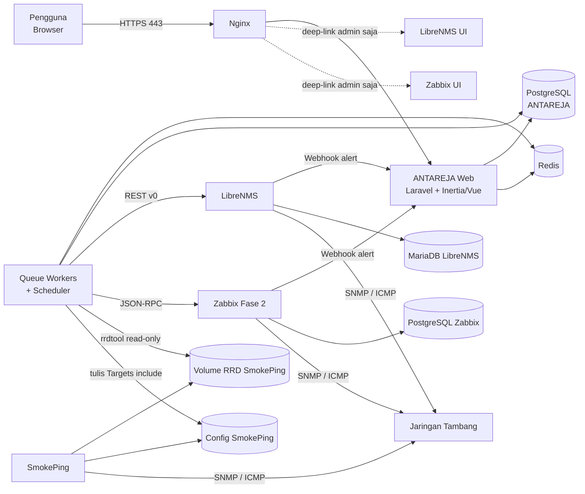
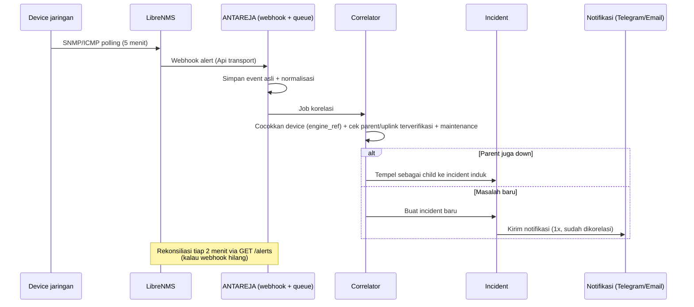

# ANTAREJA NMS — Dokumen Analisis & Arsitektur (v0.1, ringkas)

**Mining ICT Infrastructure Management & Unified Network Monitoring Platform**
Status: DRAFT untuk disetujui — belum ada kode aplikasi yang ditulis.
Tanggal: 19 November 2026

> Legenda verifikasi:
> ✅ = diverifikasi langsung dari source code yang diperiksa
> ⚠️ = belum diverifikasi dari source (pengetahuan umum / perlu dicek saat implementasi)

---

## Ringkasan Keputusan Utama

| # | Keputusan | Alasan |
|---|---|---|
| K1 | **Fase 1 (MVP): LibreNMS + SmokePing. Zabbix masuk Fase 2.** | LibreNMS sudah mencakup ±80% kebutuhan monitoring jaringan. Zabbix tumpang-tindih (SNMP, alert, discovery); menjalankan keduanya sejak awal = beban perawatan ganda untuk 1 orang. Adapter Zabbix tetap dirancang dari awal. |
| K2 | **Satu device = satu engine pemilik polling.** | Mencegah polling ganda & alert dobel. |
| K3 | **ANTAREJA dibangun sendiri di Laravel** (inventory, IPAM, mapping, incident, SLA, dll). | Satu login, satu UI, satu database aplikasi. Tidak menambah sistem ke-4 (NetBox). |
| K4 | **Engine tidak dimodifikasi.** Integrasi hanya via API resmi, webhook alert resmi, dan file data/konfigurasi resmi. | Upgrade engine tetap mudah; kepatuhan lisensi sederhana. |
| K5 | **Deploy: 1 VM Ubuntu Server LTS di Proxmox, Docker Compose.** | Sesuai lingkungan Anda; tanpa ketergantungan cloud. |
| K6 | **Stack ANTAREJA: Laravel + Inertia.js + Vue 3 + Tailwind, PostgreSQL, Redis.** | Satu bahasa backend, UI modern, mudah dirawat sendiri. |

---

## 1. Source Code Audit Report

| Item | LibreNMS | Zabbix | SmokePing |
|---|---|---|---|
| Sumber | github.com/librenms/librenms (shallow clone) | github.com/zabbix/zabbix (shallow clone) | ZIP upload `SmokePing-master` |
| Commit / versi | `0be3b7a` (19 Nov 2026) ✅ | `9123cf4` (17 Nov 2026), **8.2.0alpha1** ✅ | **2.9.0** ✅ |
| Catatan stabilitas | Branch master (rolling) | **Alpha** — untuk produksi wajib pakai rilis LTS stabil, bukan master ⚠️ | Master; pakai rilis tag 2.9.x |
| Bahasa inti | PHP (Laravel) + Python (poller dispatcher) | C (server/proxy/agent), PHP (frontend + API) | Perl (daemon + CGI), RRDtool |
| Penyimpanan data | MySQL/MariaDB + file RRD | MySQL / PostgreSQL | File RRD (+ opsional InfluxDB 1.x) |
| Antarmuka integrasi resmi | REST API `/api/v0` (stabil), `/api/v1` (beta, nonaktif default) ✅ | JSON-RPC `ui/api_jsonrpc.php`, auth Bearer token ✅ | **Tidak ada REST/JSON API** ✅. Data via file RRD; konfigurasi via file (`@include` didukung) ✅ |

**Temuan penting:**
- LibreNMS **dibangun di atas Laravel** (`laravel/framework ^13.32`, PHP ^8.4) ✅ — stack yang sama dengan ANTAREJA, memudahkan pemahaman, tetapi kita **tidak** menggabungkan kode ke dalamnya.
- LibreNMS API v0 punya **144 route** ✅, termasuk: devices, ports, alerts, ARP, FDB, links (LLDP/CDP), IP addresses/networks, VLAN, sensors, wireless sensors, inventory, locations, availability, outages, maintenance, eventlog, oxidized (config backup).
- LibreNMS punya definisi OS untuk vendor yang relevan ✅: `routeros` (MikroTik), `ruijie`, `fs-ruijie`, `airos`, `airos-af*`, `unifi`, `edgeos`, `edgeswitch`, `mimosa`, `hikvision-cam`, `hikvision-nvr`, `dahua-nvr`, `axiscam`, `fortigate`, `pfsense`, `sophos-xg`, `ios/iosxe`, `apc`, `eatonups`, `proxmox`, `vmware-esxi`.
- Zabbix API punya service: `host`, `hostgroup`, `item`, `trigger`, `problem`, `event`, `history`, `trend`, `service`, `sla`, `maintenance`, `mediatype`, `token`, `report`, `discoveryrule`, dll ✅. Template bawaan termasuk `cctv/hikvision`, `net/mikrotik`, `net/ubiquiti_airos_snmp`, `net/fortinet`, `power/apc`, `net/icmp_ping` ✅.
- SmokePing ekspor InfluxDB memakai `InfluxDB::HTTP` dengan parameter `host/port/database/username/password` → **InfluxDB 1.x**, bukan 2.x ✅. Field: `loss`, `loss_percent`, `median`, `min`, `max`, `ping1..N`; tag: `host`, `title`, `path`, `slave` ✅.

## 2. Technology Stack Analysis

| Lapisan | Pilihan | Catatan |
|---|---|---|
| OS | Ubuntu Server 24.04 LTS (VM Proxmox) | |
| Container | Docker Engine + Docker Compose v2 | |
| Reverse proxy | Nginx (TLS, satu pintu masuk) | Sertifikat internal / self-signed / CA perusahaan |
| Backend | Laravel 12/13, PHP 8.4 | Service layer + Adapter + Repository seperlunya |
| Frontend | Inertia.js + Vue 3 + Tailwind CSS + Chart library (ECharts) | SPA rasa, tetapi routing & auth di Laravel |
| Queue/Cache | Redis + Laravel Horizon | Sinkronisasi, ingest webhook, rollup |
| Scheduler | Laravel Scheduler (container `scheduler`) | |
| DB aplikasi | PostgreSQL 16 | Tipe `inet/cidr` native → ideal untuk IPAM (IPv4 & IPv6) |
| Export | `maatwebsite/excel` (XLSX/CSV), DomPDF/Browsershot (PDF) | ⚠️ pilih saat implementasi |
| Auth | Laravel Fortify/Breeze + `spatie/laravel-permission` | RBAC granular |
| Audit | `spatie/laravel-activitylog` atau tabel audit sendiri | |

## 3. License Compliance Report

| Komponen | Lisensi | Bukti | Implikasi |
|---|---|---|---|
| LibreNMS | **GPLv3** (+ pengecualian paket pihak ketiga, lihat README) | `LICENSE.txt` ✅ | Dipakai apa adanya sebagai layanan terpisah. Bila dimodifikasi & didistribusikan → wajib buka source modifikasi. |
| Zabbix | **AGPLv3** | `COPYING` ✅ | Bila Zabbix **dimodifikasi** dan diakses pengguna lewat jaringan → wajib menyediakan source modifikasi. Kita **tidak memodifikasi**, jadi kewajiban ini praktis tidak terpicu. |
| SmokePing | **GPLv2 or later** | `LICENSE`, `COPYRIGHT` ✅ | Sama seperti di atas. |
| ANTAREJA NMS | Ditentukan Anda (mis. proprietary internal / MIT) | — | Berkomunikasi lewat API/webhook/file data = **program terpisah**, bukan karya turunan. Jangan menyalin kode engine ke dalam ANTAREJA. |

**Aturan kepatuhan:**
1. Folder `upstream/` berisi salinan asli, **tidak diedit**. File LICENSE/COPYRIGHT tidak dihapus.
2. Image Docker engine memakai image resmi/upstream; jika ada patch, dicatat di `docs/MODIFICATIONS.md`.
3. Halaman "About / Licenses" di ANTAREJA mencantumkan ketiga engine beserta lisensinya.
4. Dependensi pihak ketiga ANTAREJA (composer/npm) dicek lisensinya dengan `composer licenses` & `license-checker` sebelum rilis.
5. ⚠️ Logo/merek "Zabbix" dan "LibreNMS" tidak dipakai sebagai merek ANTAREJA.

**Catatan non-teknis (penting):** karena memindai dan menyimpan data jaringan perusahaan, mintalah persetujuan tertulis atasan/IT Security, dan sepakati kepemilikan kode bila nanti dipakai resmi.

## 4. Functional Comparison Matrix

| Kemampuan | LibreNMS | Zabbix | SmokePing | ANTAREJA (custom) |
|---|---|---|---|---|
| Auto-discovery (SNMP scan, LLDP/CDP, ARP) | ✅ Kuat | ✅ (discovery rule) | ❌ | Alur verifikasi |
| SNMP v2c/v3 polling | ✅ | ✅ | ❌ | ❌ |
| Port/traffic/bandwidth | ✅ Kuat, otomatis | ✅ via template | ❌ | Tampilan + rollup |
| Sensor hardware/suhu | ✅ | ✅ | ❌ | Tampilan |
| Wireless (sinyal, client, freq) | ✅ wireless sensors | ⚠️ per template | ❌ | Tampilan |
| ICMP availability | ✅ | ✅ | ✅ (kualitas) | ❌ |
| Latency/loss/jitter historis | Dasar | Dasar | ✅ Terbaik | Tampilan |
| Trigger/alert engine | ✅ Rule-based | ✅ Terkuat | Dasar | Korelasi & incident |
| Service/SLA | ❌ terbatas | ✅ `service`, `sla` | ❌ | ✅ SLA bisnis |
| Maintenance window | ✅ | ✅ | ❌ | ✅ (sumber kebenaran) |
| Config backup | ✅ via Oxidized | ❌ | ❌ | Referensi |
| ARP/FDB/MAC lookup | ✅ | ⚠️ terbatas | ❌ | Saran mapping & IPAM |
| Inventory aset, PIC, garansi | ❌ minim | ⚠️ host inventory dasar | ❌ | ✅ |
| IPAM | ❌ (hanya IP terlihat) | ❌ | ❌ | ✅ |
| Incident/work order/maintenance | ❌ | ❌ | ❌ | ✅ |
| Fiber optic | ❌ | ❌ | ❌ | ✅ (fase lanjut) |

**Bisa diintegrasikan langsung:** discovery, polling SNMP, port/traffic, sensor, wireless sensor, ARP/FDB/LLDP, alert, availability/outage (LibreNMS); latency/loss (SmokePing); problem/event/SLA (Zabbix fase 2).
**Perlu custom development:** inventory resmi + verifikasi, site/area, IPAM, device mapping, alert center terpadu + korelasi, incident, SLA bisnis, maintenance/change, work order, laporan, RBAC, audit, data quality, fiber, AI.

## 5. Overlapping Functionality Analysis & Kepemilikan Tanggung Jawab

| Tanggung jawab | Pemilik | Engine lain |
|---|---|---|
| Discovery perangkat jaringan | **LibreNMS** | Zabbix discovery **dimatikan** |
| SNMP polling switch/router/AP/radio/firewall/UPS | **LibreNMS** | Zabbix tidak polling device yang sama |
| CCTV & NVR (ping + SNMP bila didukung) | **LibreNMS** (Fase 1) | Fase 2 opsional pindah ke Zabbix bila perlu template HTTP Hikvision/ISAPI |
| Latency/loss/jitter link kritis (WAN, PTP, gateway site) | **SmokePing** | — |
| Server, VM, aplikasi, HTTP/API check | **Zabbix** (Fase 2) | — |
| Business service & SLA tree | **ANTAREJA** (dihitung dari data outage) | Zabbix `sla` boleh jadi pembanding fase 2 |
| Alert → Incident | **ANTAREJA** | Engine hanya mengirim event |
| Maintenance window | **ANTAREJA** (sumber kebenaran) → dipush ke LibreNMS/Zabbix via API | — |
| Notifikasi (Telegram/email) | **ANTAREJA** (setelah korelasi) | Notifikasi langsung engine dimatikan agar tidak dobel |

Aturan teknis: tiap record device punya `primary_engine` + `engine_refs` (librenms_device_id, zabbix_hostid, smokeping_path). Saat device diaktifkan di Zabbix, ANTAREJA memastikan device itu tidak dipoll SNMP penuh oleh LibreNMS (atau sebaliknya).

## 6. API Integration Analysis

### 6.1 LibreNMS (REST v0) ✅
- Base: `http://librenms:8000/api/v0`, header `Authorization: Bearer <token>` (atau `X-Auth-Token`). Token dibuat di UI `/api-access/` dengan opsi kedaluwarsa.
- Endpoint yang dipakai (semua terverifikasi di `routes/api.php`):

| Kebutuhan | Endpoint |
|---|---|
| Daftar & detail device | `GET /devices`, `GET /devices/{hostname}` |
| Port & status | `GET /devices/{hostname}/ports`, `GET /ports/{portid}`, `GET /ports/search/{field}/{search}` |
| Sensor & wireless | `GET /devices/{hostname}/health/{type?}`, `GET /devices/{hostname}/wireless/{type?}`, `GET /resources/sensors` |
| Availability & outage (SLA) | `GET /devices/{hostname}/availability`, `GET /devices/{hostname}/outages` |
| Alert | `GET /alerts`, `PUT /alerts/{id}` (ack), `GET /logs/alertlog/{hostname?}` |
| Saran mapping | `GET /resources/links`, `GET /resources/fdb`, `GET /devices/{hostname}/fdb`, `GET /ports/mac/{search}` |
| IPAM (IP terlihat) | `GET /resources/ip/addresses`, `GET /resources/ip/networks`, `GET /resources/ip/arp/{query}`, `GET /resources/vlans` |
| Hardware inventory | `GET /resources/inventory/{hostname}`, `GET /resources/inventory/{hostname}/all` |
| Lokasi | `GET /resources/locations`, `POST /locations` |
| Maintenance | `POST /devices/{hostname}/maintenance`, `POST /devicegroups/{name}/maintenance` |
| Tambah device | `POST /devices` |
| Config backup | `GET /oxidized/config/{device_name}` (bila Oxidized dipasang) |
| Kesehatan | `GET /system`, `GET /v1/health` (v1 beta) |

✅ Prefix grup (`/devices`, `/ports`, `/logs`, `/resources`) sudah dicek di `routes/api.php`. ⚠️ **Format respons & pagination** akan diverifikasi dengan contract test terhadap instance nyata sebelum adapter dianggap selesai.
- **Push event:** transport alert `Api` resmi (`LibreNMS/Alert/Transport/Api.php`) ✅ — mendukung method, URL, header, body bertemplate, basic auth → dikirim ke webhook ANTAREJA.
- **Auto-discovery:** dikonfigurasi dengan `lnms config:set nets.+ '<subnet>'` dan `autodiscovery.nets-exclude` ✅.

### 6.2 Zabbix (JSON-RPC, Fase 2) ✅
- Endpoint: `POST http://zabbix-web:8080/api_jsonrpc.php`, header `Authorization: Bearer <api-token>` ✅.
- Method yang dipakai: `apiinfo.version`, `host.get/create/update`, `hostgroup.get`, `problem.get`, `event.get`, `event.acknowledge`, `trigger.get`, `history.get`, `trend.get`, `service.get`, `sla.get`, `sla.getsli`, `maintenance.create`, `mediatype.*` (⚠️ parameter detail mengikuti versi LTS yang dipasang).
- **Push event:** media type webhook (JavaScript) Zabbix → webhook ANTAREJA.
- ⚠️ Source yang diperiksa adalah **8.2.0alpha1**. Produksi memakai rilis LTS stabil; adapter mengecek `apiinfo.version` saat start.

### 6.3 SmokePing (tanpa API) ✅
- **Baca data:** container ANTAREJA me-mount volume data SmokePing **read-only** dan menjalankan `rrdtool xport/fetch` → median, loss, min/max; jitter dihitung dari sebaran `ping1..N` (stddev median per interval).
- **Kelola target:** ANTAREJA membuat file `Targets.antareja` lalu SmokePing memakai `@include` (fitur resmi Config::Grammar) ✅; reload daemon setelah validasi konfigurasi (`smokeping --check`). Target dikurasi (±30–100 link kritis), **bukan** semua device.
- Alternatif: ekspor InfluxDB 1.x bawaan — **tidak dipakai di MVP** (menambah 1 database).

### 6.4 Kontrak Adapter (sama untuk ketiganya)
```php
interface MonitoringAdapter {
    public function healthCheck(): AdapterHealth;            // status koneksi + versi engine
    public function listDevices(?Cursor $c): DevicePage;      // ternormalisasi -> NormalizedDevice
    public function getDeviceStatus(string $ref): DeviceStatus;
    public function listActiveAlerts(): array;                // -> NormalizedEvent[]
    public function acknowledge(string $eventRef, string $note): void;
    public function getOutages(string $ref, Period $p): array;// untuk SLA
    public function setMaintenance(string $ref, Period $p): void;
}
```
Setiap adapter: kredensial terenkripsi dari DB, timeout + retry eksponensial, circuit breaker (tandai engine "degraded" setelah N gagal), logging request/response (tanpa token), normalisasi ke DTO bersama, dan `source_engine` + `source_id` asli selalu disimpan.

## 7. Unified System Architecture



**Modul Laravel (`app/Modules/*`):** Core (Auth, RBAC, Audit, Settings), Site, Inventory, Discovery, Mapping, IPAM, Monitoring, Wireless, CCTV, NetworkQuality, Events, Incidents, SLA, Maintenance, Reports, DataQuality; fase lanjut: WorkOrder, ConfigTracking, Capacity, Fiber, AI.

**Navigasi:** 17 menu sesuai spesifikasi. Menu yang modulnya belum dibangun disembunyikan (bukan halaman kosong).

**Fallback deep-link:** untuk fitur engine yang tidak wajar dibuat ulang (grafik RRD detail LibreNMS, konfigurasi template Zabbix), tombol "Buka di LibreNMS/Zabbix" muncul kontekstual hanya untuk role Admin/Network. UI engine berada di path internal (`/engine/librenms`, `/engine/zabbix`) di balik Nginx dengan akun terpisah.

## 8. Database Architecture

Tiga database terpisah, **tidak saling menulis**:
1. `antareja` (PostgreSQL) — data aplikasi.
2. `librenms` (MariaDB) — milik LibreNMS.
3. `zabbix` (PostgreSQL, instance terpisah) — milik Zabbix (Fase 2).
SmokePing: file RRD.

**Tabel inti ANTAREJA (ringkas):**

| Domain | Tabel |
|---|---|
| Lokasi | `sites` (tipe: office, workshop, plant, pit, ROM, jetty, warehouse, mess, remote), `areas`, `racks` |
| Inventaris | `devices`, `device_categories`, `vendors`, `device_models`, `device_engine_refs`, `device_attachments` (evidence), `asset_lifecycle_events` |
| Discovery | `discovery_candidates` (status: discovered, pending_verification, verified, incomplete_mapping, rejected, retired), `discovery_reviews` |
| Mapping | `device_links` (A-device/port ↔ B-device/port, tipe: uplink, ap_port, cctv_port, nvr_camera, ptp_pair; status: suggested/verified), `device_contacts` (PIC) |
| IPAM | `vlans`, `subnets` (`cidr`), `ip_addresses` (`inet`, status: used/available/reserved/static/dhcp), `ip_assignments_history` |
| Monitoring cache | `device_status_snapshots`, `port_metrics_5m` (hanya port terpilih, retensi 30 hari), `quality_metrics_5m` (retensi 30 hari), `metric_rollups_daily` (jangka panjang) |
| Event | `events` (source_engine, source_id, payload asli JSON, correlation_key), `event_groups` |
| Incident | `incidents`, `incident_events`, `incident_notes`, `incident_status_history`, `incident_attachments` |
| SLA | `sla_policies`, `sla_targets`, `availability_periods`, `sla_results` (dengan flag `data_complete`) |
| Maintenance | `maintenance_windows`, `maintenance_records`, `change_requests`, `change_approvals` |
| Sistem | `users`, `roles`, `permissions` (spatie), `integrations` (kredensial terenkripsi), `audit_logs`, `data_quality_issues` |

Index: `inet/cidr` memakai GiST untuk pencarian subnet; index pada `(source_engine, source_id)`, `correlation_key`, `device_id + created_at`. Retensi: job harian menghapus metrik 5 menit > 30 hari setelah di-rollup harian.

## 9. Authentication Architecture
- **Satu login** di ANTAREJA (Laravel session, cookie `HttpOnly`, `Secure`, `SameSite=Lax`), CSRF bawaan Laravel, rate limit login (5/menit/IP+user), opsi 2FA TOTP (Fortify).
- Fase lanjut opsional: LDAP/Active Directory perusahaan ⚠️ (bila diizinkan).
- **RBAC granular** (`spatie/laravel-permission`): permission per aksi, mis. `inventory.view`, `inventory.edit`, `discovery.approve`, `ipam.assign`, `incident.manage`, `sla.view`, `integration.manage`, `audit.view`. Role awal = kumpulan permission:
  - **ICT Network**: monitoring, inventory jaringan, IPAM, mapping, incident jaringan.
  - **ICT CCTV/Support**: CCTV, inventory CCTV, incident support, maintenance.
  - **ICT Admin**: semua + user, integrasi, audit.
  - **Management**: dashboard eksekutif, laporan, SLA (read-only).
  - Pembatasan data per kategori (Network vs CCTV) lewat policy/scope.
- **Service account engine:** token API LibreNMS/Zabbix dengan hak minimum, disimpan terenkripsi (`encrypted` cast, kunci `APP_KEY`), **tidak pernah dikirim ke browser**. Semua panggilan engine hanya dari backend.
- **Webhook masuk:** endpoint `/api/ingest/{engine}` hanya dari jaringan Docker internal + shared secret di header + validasi payload.

## 10. Data Flow Diagram



**Alur discovery:** LibreNMS auto-discover → job sinkron 15 menit membaca `GET /devices` → device yang belum ada di inventaris → `discovery_candidates` (Pending Verification) → engineer review/isi site, kategori, PIC → Approve → menjadi `devices` resmi dengan `engine_refs`. Reject → ditandai, tidak muncul lagi (opsional: dihapus/di-disable dari polling LibreNMS atas persetujuan).

**Alur saran mapping:** data LLDP/CDP (`links`) + FDB/MAC + ARP → `device_links` berstatus *suggested* → engineer verifikasi.

**Jadwal sinkron:** device & port 15 menit; status/alert webhook + rekonsiliasi 2 menit; metrik port terpilih & SmokePing 5 menit; outage/availability harian + saat laporan; rollup harian 01:00.

**Strategi korelasi event:**
1. `correlation_key = device_id + kelas_masalah` (device_down, port_down, high_latency, packet_loss, temperature, engine_failure). Event dari engine berbeda dengan key sama dalam jendela 10 menit → satu event group.
2. **Parent-child hanya dari mapping terverifikasi** (tidak menebak topologi): jika uplink/parent down, device anak yang down ditempel ke incident induk dan notifikasinya ditahan.
3. Event selama maintenance window → ditandai *in_maintenance*, tidak membuat incident.
4. Event asli dan ID sumber selalu disimpan; ack di ANTAREJA diteruskan ke engine (`PUT /alerts/{id}`, `event.acknowledge`).

## 11. Docker Deployment Architecture

```
/opt/antareja/
├── docker-compose.yml        # semua service
├── .env                      # konfigurasi + rahasia (chmod 600, tidak di-commit)
├── antareja.sh               # install|start|stop|restart|update|backup|restore|health
├── nginx/  certs/
├── smokeping/config/         # config + Targets.antareja (ditulis ANTAREJA)
└── backups/
```

| Service | Image | Network | Volume |
|---|---|---|---|
| nginx | nginx:stable | frontend + backend | certs |
| antareja-app (php-fpm) | build sendiri (PHP 8.4 + rrdtool) | backend | storage, smokeping-data (ro), smokeping-config |
| antareja-worker / scheduler | sama dengan app | backend | sama |
| antareja-db | postgres:16 | backend | pg-data |
| redis | redis:7 | backend | redis-data |
| librenms + dispatcher + db + rrdcached | image resmi `librenms/librenms` ⚠️ + mariadb | backend + **monitoring (akses jaringan device)** | librenms-data, rrd, mariadb-data |
| smokeping | ⚠️ image komunitas (mis. linuxserver) atau build dari source 2.9.x | monitoring | smokeping-data, smokeping-config |
| zabbix-server/web/db (Fase 2) | image resmi `zabbix/*` LTS ⚠️ | backend + monitoring | zabbix-db |

- Hanya **Nginx** yang mempublikasikan port (443, opsional 80→443). Port DB/Redis/engine tidak diekspos.
- SNMP trap/syslog (opsional) dibuka ke subnet manajemen saja.
- ⚠️ Untuk ICMP/SNMP dari container, perlu `cap_add: NET_RAW` pada poller; diuji saat implementasi.

**Perintah operasional (`antareja.sh`):** `install` (cek prasyarat, buat `.env` dengan rahasia acak, pull/build, migrate, buat admin), `start`, `stop`, `restart`, `update` (backup otomatis → pull → migrate → health), `backup` (pg_dump + mysqldump + tar RRD/config, rotasi 7 harian + 4 mingguan), `restore <file>`, `health` (status container, koneksi DB, health tiap adapter).

**Backup:** salin ke luar VM (NAS/share perusahaan) + backup VM Proxmox (vzdump) mingguan. Prosedur restore diuji sekali per bulan.

## 12. Security Architecture
- TLS di Nginx; HSTS internal; header keamanan (CSP, X-Frame-Options DENY).
- Laravel: validasi Form Request, Eloquent/parameter binding (anti SQL injection), CSRF, rate limiting (login, API, webhook), session regenerate saat login, password hashing bcrypt/argon2.
- Rahasia hanya di `.env` dan tabel `integrations` terenkripsi; tidak ada kredensial di kode atau frontend.
- SNMP v3 (authPriv) diutamakan; community v2c read-only, tidak memakai `public`.
- **Segmentasi:** VM ANTAREJA ditempatkan di VLAN manajemen; firewall: dari VM ke device hanya UDP 161/ICMP (+SSH bila Oxidized); dari pengguna ke VM hanya 443.
- Least privilege: token engine read-only kecuali ack & maintenance; ANTAREJA **tidak pernah push konfigurasi** ke device.
- Audit log untuk login, perubahan inventory/IP/mapping/incident/maintenance/permission/integrasi (siapa, kapan, sebelum/sesudah, IP).
- Update keamanan: `antareja.sh update` + `unattended-upgrades` di Ubuntu.

## 13. Integration Risk Register

| ID | Risiko | Dampak | Kemungkinan | Mitigasi |
|---|---|---|---|---|
| R1 | Cakupan terlalu besar untuk 1 orang | Proyek tidak selesai | Tinggi | MVP sempit, fase bertahap, modul tersembunyi sampai siap |
| R2 | Format respons/pagination API LibreNMS berubah antar versi | Adapter rusak | Sedang | Pin versi image, contract test, adapter cek versi |
| R3 | Zabbix source yang diperiksa alpha 8.2 | API beda dengan LTS | Sedang | Pakai LTS, validasi `apiinfo.version`, Fase 2 |
| R4 | SmokePing tanpa API; struktur RRD/path berubah | Data kualitas hilang | Rendah | Baca read-only, path dari config yang kita tulis sendiri |
| R5 | Polling ganda LibreNMS & Zabbix | Beban device/radio, alert dobel | Sedang | Aturan `primary_engine`, discovery Zabbix mati |
| R6 | Webhook hilang saat ANTAREJA down | Alert terlewat | Sedang | Rekonsiliasi berkala `GET /alerts` / `problem.get` |
| R7 | Vendor (CCTV murah, radio) tidak mendukung SNMP | Data tidak lengkap | Tinggi | ICMP-only fallback; tampilkan "metrik tidak tersedia", jangan dikarang |
| R8 | Data SLA tidak lengkap (engine mati, gap) | Laporan SLA salah | Sedang | Flag `data_complete`; SLA "tidak dapat dihitung" bila gap > ambang |
| R9 | Pemindaian jaringan tanpa izin | Masalah kebijakan/keamanan | Sedang | Persetujuan tertulis sebelum aktifkan discovery |
| R10 | VM tunggal gagal / disk penuh | Monitoring mati | Sedang | Backup luar VM, monitoring disk, retensi RRD |
| R11 | Link remote (PTP/PTMP) lambat/putus | Timeout polling, false alarm | Tinggi | Timeout per site, korelasi parent-child, poller group (fase lanjut: poller di site remote) |

## 14. Development Roadmap

| Fase | Isi | Estimasi (kerja paruh waktu) |
|---|---|---|
| **0. Fondasi** | Docker Compose semua engine berjalan, skrip `antareja.sh`, Laravel skeleton, login, RBAC, audit, layout UI + navigasi | 2–3 minggu |
| **1. MVP** | Site/Area, Inventory, Discovery + verifikasi (LibreNMSAdapter), Device Mapping manual + saran LLDP/FDB, IPAM dasar, Dashboard teknis, Event & Alert Center (webhook + rekonsiliasi), Network Quality (SmokePingAdapter), Data quality dasar | 8–10 minggu |
| **2. Operasional** | Incident management + korelasi parent-child, Maintenance window (push ke engine), Notifikasi Telegram/email, Wireless & CCTV view khusus, ZabbixAdapter + server/HTTP monitoring | 6–8 minggu |
| **3. Manajemen** | SLA policy & laporan bulanan, Dashboard manajemen, Export PDF/Excel/CSV, MTTR/MTBF | 4–6 minggu |
| **4. Lanjutan** | Work order, change management, config tracking (Oxidized), capacity planning, asset lifecycle penuh | bertahap |
| **5. Masa depan** | Fiber optic management, AI-assisted ops (ringkasan incident, anomali) — tanpa eksekusi perubahan konfigurasi | bertahap |

Setiap integrasi mengikuti: identifikasi interface resmi → dokumentasi → kontrak data → adapter → test → dokumentasi failure handling.

## 15. Estimated Infrastructure Requirements

| Skala | vCPU | RAM | Disk (SSD) | Catatan |
|---|---|---|---|---|
| MVP, ≤150 device (LibreNMS + SmokePing + ANTAREJA) | 4 | 8 GB | 150 GB | |
| 500 device, Fase 1–3 | 6–8 | 16 GB | 250 GB | RRD LibreNMS ±30–60 GB ⚠️ (tergantung jumlah port/sensor) |
| 500 device + Zabbix (Fase 2+) | 8–12 | 24 GB | 400 GB | Zabbix DB tumbuh sesuai item & retensi history |

- Disk: ZFS/LVM thin di Proxmox, pantau IOPS (RRD sangat I/O intensif → pakai `rrdcached`).
- Jaringan: 1 NIC di VLAN manajemen dengan rute ke semua subnet device; opsi NIC kedua untuk akses pengguna.
- Backup: ruang tambahan ±2× ukuran database + RRD di NAS.

---

## Hal yang Belum Dapat Diverifikasi dari Source

1. Struktur JSON respons dan pagination tiap endpoint LibreNMS v0 → diuji terhadap instance nyata (Fase 0).
2. Detail parameter Zabbix API pada versi LTS yang akan dipasang (yang diperiksa: 8.2.0alpha1).
3. Nama/versi image Docker resmi LibreNMS, Zabbix, SmokePing (tidak ada di repo yang diperiksa).
4. Metrik spesifik per model Ruijie/Ubiquiti/Hikvision di perangkat Anda — tergantung firmware & dukungan SNMP.
5. Kebijakan perusahaan soal pemindaian jaringan, LDAP, dan notifikasi eksternal (Telegram butuh internet).

## Langkah Berikutnya (menunggu persetujuan Anda)
Bila disetujui, mulai **Fase 0**: struktur repo, `docker-compose.yml`, `antareja.sh`, Laravel skeleton dengan login + RBAC + layout navigasi, lalu uji LibreNMSAdapter terhadap LibreNMS yang berjalan.
