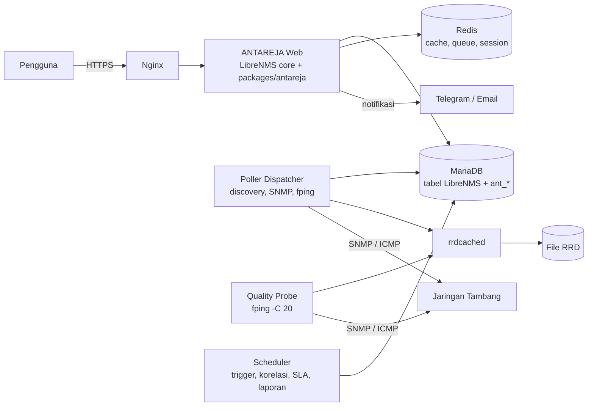

# ANTAREJA NMS — Arsitektur v0.2 (Pendekatan Fork LibreNMS)

Status: DRAFT untuk disetujui · 19 November 2026
Menggantikan pendekatan "integrasi API" pada v0.1. Bagian v0.1 yang tidak disebut di sini (keamanan umum, kebutuhan VM, dsb.) tetap berlaku kecuali dinyatakan lain.

> ✅ = diverifikasi dari source code · ⚠️ = belum diverifikasi / diuji saat implementasi

---

## 1. Perubahan Pendekatan

| | v0.1 (lama) | **v0.2 (sekarang)** |
|---|---|---|
| Bentuk | ANTAREJA + 3 engine terpisah, dihubungkan API | **Satu aplikasi**: ANTAREJA = fork LibreNMS + modul tambahan |
| Database | 3–4 database | **Satu database** (MariaDB) + file RRD |
| Fitur LibreNMS | Diambil via API | **Dimiliki langsung** (kode inti fork) |
| Fitur Zabbix | Diambil via API | **Dibuat ulang** sebagai modul native (konsep & perilaku, bukan salin kode C) |
| Fitur SmokePing | Baca file RRD | **Dibuat ulang** sebagai modul native (probe ping berulang + grafik smoke) |
| Lisensi ANTAREJA | Bebas | **GPLv3** (mengikuti LibreNMS) |

---

## 2. Fakta Teknis LibreNMS yang Menjadi Fondasi ✅

| Aspek | Temuan |
|---|---|
| Framework | Laravel 13, PHP 8.4 |
| Frontend | Blade + Bootstrap 4 + jQuery + **Alpine.js + Tailwind 4**, dibangun dengan Vite |
| RBAC | Sudah memakai `spatie/laravel-permission` (+ `RoleController`) |
| **Sistem plugin** | Plugin bisa berupa **paket Laravel (composer)** dengan hook: `MenuEntryHook`, `PageHook`, `DeviceOverviewHook`, `PortTabHook`, `SettingsHook` (`app/Plugins/Hooks`, `doc/Extensions/Plugin-System.md`) |
| Model data | 148 model: Device, Port, Sensor, WirelessSensor, Location, DeviceGroup, Vlan, Ipv4/6Address & Network, Ipv4Mac (ARP), PortsFdb, Link (LLDP/CDP), Alert/AlertRule/AlertSchedule, DeviceOutage, Availability, DeviceRelationship (parent/child), CustomMap, Service, Eventlog, Syslog, dll |
| Dukungan vendor | 824 definisi OS (MikroTik, Ruijie, Ubiquiti, Hikvision, Dahua, Fortigate, APC, Eaton, dst) |
| ICMP | `fping`, default 3 paket per poll; hasil ke tabel `device_stats` + RRD `icmp-perf` (avg/min/max/loss) |
| Maintenance | `AlertSchedule` (jadwal maintenance yang menekan alert) |
| Dependensi parent/child | `DeviceRelationship` — dipakai untuk menekan alert anak saat parent down |

**Kesimpulan:** ±60% kebutuhan ANTAREJA sudah ada di LibreNMS. Pekerjaan kita: (a) rebranding & UX, (b) modul ala Zabbix, (c) modul ala SmokePing, (d) modul khusus tambang.

---

## 3. Strategi Fork (agar tetap bisa menerima update LibreNMS)

```
antareja-nms/                 ← repo GitHub pribadi Anda
├── (seluruh kode LibreNMS)   ← fork, perubahan inti DIMINIMALKAN
├── packages/antareja/        ← SEMUA fitur baru ada di sini (paket Laravel)
│   ├── src/Modules/{Inventory,Discovery,Ipam,Mapping,Quality,Triggers,
│   │                Problems,Incidents,Sla,Maintenance,Reports,DataQuality,...}
│   ├── database/migrations/  ← tabel baru berprefiks ant_
│   ├── resources/views/      ← Blade + Alpine + Tailwind
│   └── routes/
├── docs/                     ← dokumen ANTAREJA
├── docker/                   ← compose, nginx, skrip antareja.sh
├── LICENSE.txt, README asli  ← TIDAK dihapus
└── MODIFICATIONS.md          ← daftar setiap perubahan pada kode inti LibreNMS
```

Aturan:
1. **Remote `upstream`** = librenms/librenms. Update ditarik berkala (bulanan) dari **rilis bertag**, bukan master.
2. Branch: `upstream-sync` (bersih dari upstream), `main` (ANTAREJA).
3. Fitur baru → `packages/antareja` lewat hook plugin & service provider. **Perubahan ke file inti hanya bila tidak ada hook**, dicatat di `MODIFICATIONS.md` dan dibuat sekecil mungkin.
4. Tabel baru berprefiks `ant_`; tabel LibreNMS tidak diubah strukturnya (kolom tambahan disimpan di tabel `ant_*` dengan relasi `device_id`).
5. Rebranding (nama, logo, warna, menu) lewat tema/config + patch kecil terdokumentasi.

---

## 4. Pemetaan Fitur: Dari Mana Asalnya

Keterangan sumber: **L** = sudah ada di LibreNMS · **Z** = tiru Zabbix · **S** = tiru SmokePing · **B** = baru (khusus tambang)
Ukuran: K = kecil, S = sedang, B = besar

| Menu ANTAREJA | Sumber | Pekerjaan | Ukuran |
|---|---|---|---|
| Dashboard teknis | L + B | Widget baru (ringkasan status per site/kategori), filter site/departemen/vendor | S |
| Dashboard manajemen | B | KPI: availability, SLA, incident, MTTR, tren | S |
| Network Monitoring | **L** | Rebrand; tambah filter site/kategori | K |
| Device Inventory | L + B | Field tambahan: serial, PIC, rak, garansi, tanggal instalasi, evidence, kategori tambang | S |
| Device Discovery + verifikasi | L + B | Discovery LibreNMS tetap; device baru masuk status *Pending Verification* sampai disetujui engineer | S |
| Device Mapping | L + B | Saran dari LLDP/CDP/FDB/ARP (L), tabel relasi terverifikasi (B). **Tanpa topologi otomatis** | S |
| IPAM | L + B | IP yang terlihat (L) + subnet/VLAN plan, alokasi, reserved, duplikat, histori, utilisasi (B) | B |
| Interface Monitoring | **L** | Rebrand | K |
| Wireless Monitoring | **L** | Halaman ringkas PTP/PTMP/AP (sinyal, client, freq) | K |
| CCTV Infrastructure | L + B | Halaman CCTV: kamera ↔ NVR ↔ port switch, status, PIC | S |
| Network Quality | **S** | Modul probe kualitas (lihat §6) | S |
| Event & Alert Center | L + **Z** | Alert LibreNMS + model *Problem* ala Zabbix (ack, assign, severity, korelasi) | B |
| Incident Management | B | Modul penuh | B |
| SLA Management | L + **Z** + B | Availability/outage (L) + service tree & SLA ala Zabbix (Z) + kebijakan maintenance (B) | B |
| Maintenance Management | L + B | AlertSchedule (L) + kalender, preventive/corrective, change request (B) | S |
| Reports | B | PDF/Excel/CSV bulanan | S |
| User Management | **L** | Role & permission ANTAREJA di atas spatie yang sudah ada | K |
| System Administration | L + B | Settings LibreNMS + audit log & data quality | S |

---

## 5. Fitur Zabbix yang Dibuat Ulang (prioritas)

| Prioritas | Fitur Zabbix | Implementasi di ANTAREJA |
|---|---|---|
| P1 | **Problem & event lifecycle** (problem, recovery, acknowledge, severity 6 tingkat, komentar) | Tabel `ant_problems`, `ant_problem_events`, `ant_problem_acks`; dibuat dari alert LibreNMS + hasil trigger ANTAREJA |
| P1 | **Event correlation** (tag-based, suppress duplikat) | `correlation_key` (device + kelas masalah) + parent/child dari `DeviceRelationship` & mapping terverifikasi |
| P1 | **Maintenance dengan/ tanpa pengumpulan data** | Perluasan AlertSchedule + kebijakan SLA |
| P2 | **Trigger expression** (mis. `avg(latency,15m) > 100`, `count(down,1h) >= 3`, hysteresis/recovery expression) | Evaluator ekspresi sederhana atas metrik yang sudah dikumpulkan (RRD/DB); dijalankan oleh scheduler tiap menit |
| P2 | **Services & SLA tree** (service induk–anak, aturan status, SLI) | `ant_services` (pohon), `ant_service_members` (device/port/probe), perhitungan SLI bulanan |
| P2 | **Action & eskalasi** (notifikasi bertahap: 0 mnt → engineer, 30 mnt → supervisor) | `ant_escalation_policies`; kanal memakai transport LibreNMS (Telegram, email, dll — 50+ sudah ada ✅) |
| P2 | **Web/HTTP & API check** | Perluas `Service` LibreNMS (check HTTP sudah ada via Nagios plugins ⚠️) + probe HTTP native |
| P3 | **Scheduled reports** | Modul Reports + scheduler |
| P3 | **Trend/rollup jangka panjang** | Tabel rollup harian/bulanan untuk laporan |
| Tidak diambil | Agent Zabbix, proxy, preprocessing JavaScript, low-level discovery template | Terlalu besar; LibreNMS discovery + poller group sudah memenuhi kebutuhan jaringan. Monitoring server memakai SNMP / *applications* LibreNMS |

## 6. Fitur SmokePing yang Dibuat Ulang

| Fitur SmokePing | Implementasi |
|---|---|
| Ping berulang per interval (default SmokePing 20 ping / 5 menit) | **Quality Probe** native: `fping -C 20` untuk target terkurasi (WAN, PTP, gateway site) — terpisah dari ping availability LibreNMS (3 paket) |
| Simpan semua sampel → median, min, max, loss, sebaran | RRD per target via datastore LibreNMS (`ant-quality-<id>`): median, loss, p10/p25/p75/p90, stddev (jitter) |
| **Grafik "smoke"** (sebaran latency berlapis) | Render chart di browser (ECharts/uPlot ⚠️ dipilih saat implementasi) dari data RRD — tampilan konsisten dengan UI ANTAREJA |
| Hierarki target (Site → Link) | Target dikelompokkan per site/area tambang |
| Probe lain (DNS, HTTP, TCP) | P2: TCP connect & HTTP; DNS bila perlu |
| Multi-lokasi (master/slave) | P3: memakai *poller group* / distributed poller LibreNMS untuk mengukur dari site remote |
| Alert pola loss/latency | Lewat Trigger expression (§5) |

---

## 7. Arsitektur Aplikasi



## 8. Database
- **Satu MariaDB** (persyaratan LibreNMS). Tabel LibreNMS tetap; tabel ANTAREJA berprefiks `ant_`.
- Tabel `ant_*` utama: `ant_sites`, `ant_areas`, `ant_device_details` (serial, PIC, rak, garansi, kategori, status lifecycle), `ant_discovery_reviews`, `ant_device_links` (mapping terverifikasi), `ant_subnets`, `ant_vlans_plan`, `ant_ip_allocations`, `ant_ip_history`, `ant_quality_targets`, `ant_problems` (+ events/acks), `ant_triggers`, `ant_services`, `ant_sla_policies`, `ant_sla_results` (dengan flag `data_complete`), `ant_incidents` (+ notes, history, attachments), `ant_maintenance_*`, `ant_change_requests`, `ant_audit_logs`, `ant_data_quality_issues`.
- IPAM: MariaDB tidak punya tipe `inet/cidr` → simpan IP sebagai `VARBINARY(16)` (siap IPv6) + kolom prefix length, dengan index untuk pencarian rentang.
- Metrik deret waktu tetap di **RRD** (efisien, retensi otomatis); DB hanya untuk status, event, dan rollup laporan.

## 9. Autentikasi & Hak Akses
- Memakai login LibreNMS (session Laravel, 2FA tersedia ⚠️ cek konfigurasi) — **satu login**.
- Role ANTAREJA dibuat di atas `spatie/laravel-permission` yang sudah ada: **ICT Network**, **ICT CCTV/Support**, **ICT Admin**, **Management**, dengan permission granular (`ant.inventory.edit`, `ant.discovery.approve`, `ant.ipam.assign`, `ant.incident.manage`, `ant.sla.view`, …).
- Kredensial SNMP/SSH tersimpan terenkripsi (model `Secret` LibreNMS ✅) dan tidak pernah dikirim ke browser.

## 10. Deployment (Docker Compose, 1 VM Proxmox)

| Service | Isi |
|---|---|
| `nginx` | TLS, satu-satunya port terbuka (443) |
| `app` | ANTAREJA web (php-fpm) |
| `dispatcher` | poller/discovery LibreNMS (Python dispatcher) |
| `quality-probe` | worker probe kualitas (fping) |
| `scheduler` + `worker` | trigger, korelasi, SLA, laporan, queue |
| `mariadb` | database tunggal |
| `redis` | cache/queue/session |
| `rrdcached` | penulisan RRD efisien |
| `snmptrapd`, `syslog` | opsional |

Image `app` dibangun dari repo fork (Dockerfile sendiri, bisa mengacu pola image resmi `librenms/docker` ⚠️). Skrip `antareja.sh`: install / start / stop / restart / update / backup / restore / health (sama seperti v0.1).

## 11. Lisensi (diperbarui)
- ANTAREJA menjadi **karya turunan LibreNMS → GPLv3**. Pemakaian internal/pribadi: tidak ada kewajiban publikasi. Bila aplikasi **dibagikan ke pihak lain** (mis. perusahaan lain/vendor), source lengkap wajib ikut diberikan di bawah GPLv3.
- `LICENSE.txt`, README, dan catatan hak cipta LibreNMS **dipertahankan**; halaman About mencantumkan "Based on LibreNMS".
- Zabbix & SmokePing: **tidak ada kode yang disalin** → hanya konsep yang ditiru; tidak ada kewajiban lisensi dari keduanya. Jangan memakai nama/logo mereka sebagai merek.

## 12. Risk Register (diperbarui)

| ID | Risiko | Mitigasi |
|---|---|---|
| F1 | Konflik merge saat update upstream | Fitur di `packages/antareja`, patch inti minimal & tercatat, sinkron hanya dari rilis bertag |
| F2 | Hook plugin tidak cukup untuk UI terpadu | Patch kecil pada layout/menu; dicatat di `MODIFICATIONS.md` |
| F3 | Basis kode besar (±500 ribu baris) | Tidak menyentuh modul polling/discovery; fokus pada lapisan atas |
| F4 | Quality Probe membebani link radio | Target dikurasi, interval 5 menit, ukuran paket kecil |
| F5 | Trigger engine buatan sendiri kurang matang dibanding Zabbix | Mulai dari ekspresi sederhana yang paling dibutuhkan; diuji dengan data nyata |
| F6 | Cakupan besar untuk 1 orang | Fase ketat; menu disembunyikan sampai modul siap |
| F7 | SLA dari data tidak lengkap | Flag `data_complete`, tidak menampilkan angka SLA bila ada gap polling |
| F8 | Izin pemindaian jaringan | Persetujuan tertulis sebelum discovery aktif |

## 13. Roadmap (diperbarui)

| Fase | Isi | Estimasi paruh waktu |
|---|---|---|
| **0. Fondasi fork** | Fork + remote upstream, `packages/antareja` kosong ter-register, Docker Compose berjalan, rebranding dasar (nama/logo/warna/menu), skrip `antareja.sh`, role ANTAREJA | 2–3 minggu |
| **1. Inventaris tambang** | Site/Area, detail device (serial, PIC, rak, garansi, kategori), verifikasi discovery, mapping terverifikasi + saran LLDP/FDB, audit log | 4–6 minggu |
| **2. IPAM + Kualitas** | IPAM (subnet/VLAN plan, alokasi, duplikat, utilisasi), Quality Probe + grafik smoke, halaman Wireless & CCTV | 5–7 minggu |
| **3. Problem & Incident** | Problem/ack/korelasi ala Zabbix, incident management, eskalasi notifikasi (Telegram/email), maintenance kalender | 6–8 minggu |
| **4. SLA & Laporan** | Service tree, trigger expression, SLA bulanan, dashboard manajemen, export PDF/Excel/CSV | 5–7 minggu |
| **5. Lanjutan** | Work order, change management, config tracking (Oxidized), capacity planning, fiber optic, AI | bertahap |

## 14. Kebutuhan VM (lebih ringan dari v0.1 karena hanya 1 aplikasi)

| Skala | vCPU | RAM | Disk SSD |
|---|---|---|---|
| ≤150 device | 4 | 8 GB | 120 GB |
| 500 device | 6–8 | 16 GB | 200–250 GB |

## 15. Langkah Berikutnya
Bila disetujui, Fase 0 dimulai:
1. Buat repo GitHub pribadi `antareja-nms` (perlu Anda buat/izinkan) → push fork LibreNMS dengan remote `upstream`.
2. Pilih **rilis bertag LibreNMS terbaru** sebagai basis (bukan master).
3. Buat paket `packages/antareja` + service provider + menu ANTAREJA.
4. `docker/` + `antareja.sh` → uji jalan lokal (login, tambah 1 device, polling).
5. Rebranding dasar.
